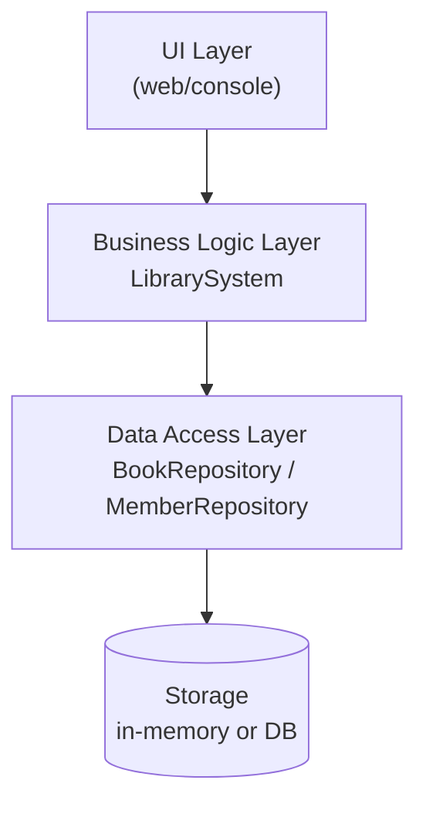
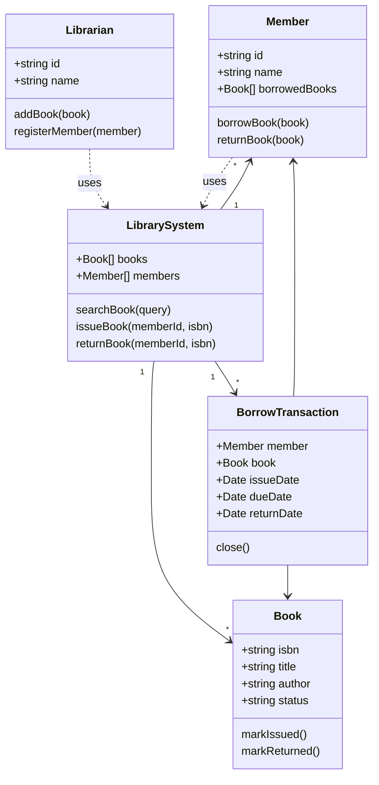
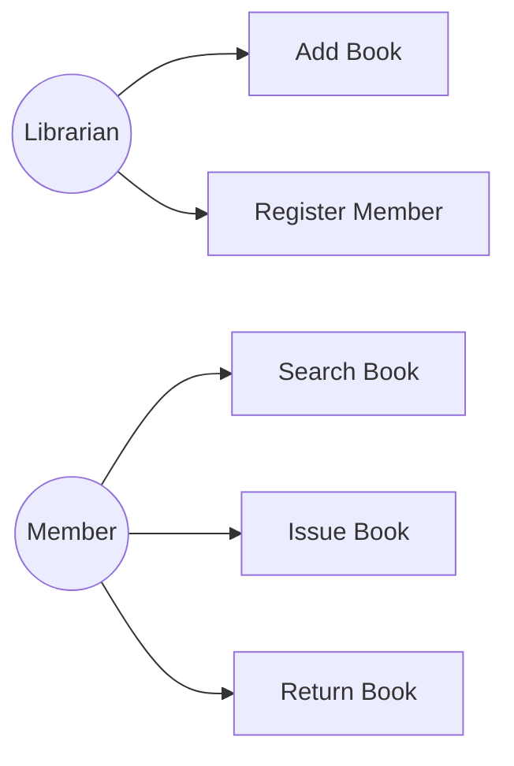
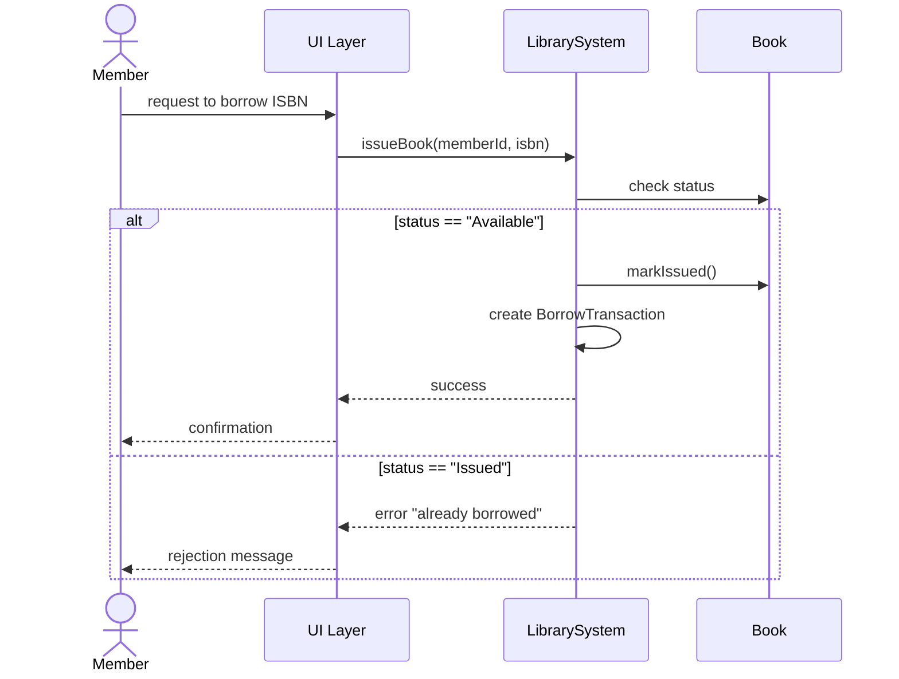
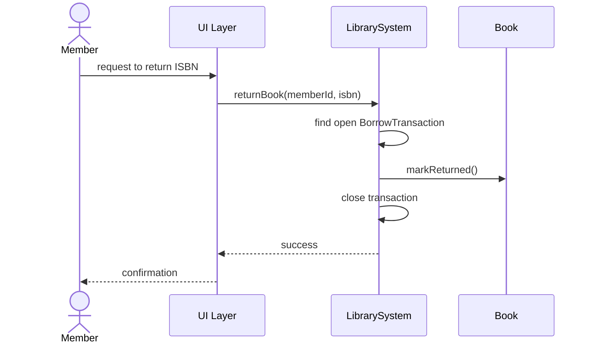
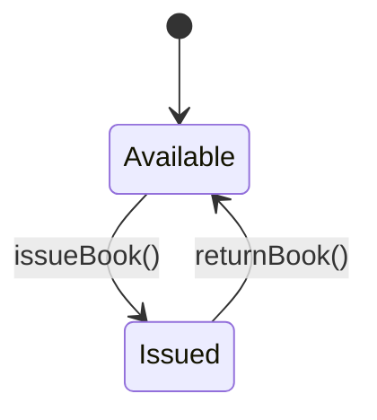

# Library Management System (LMS) — Object-Oriented Analysis & Architectural Modeling

GoMyCode checkpoint — *Low Level Design: Interaction Between System Architecture and Components & Object-Oriented Analysis*.

> Per the brief, this is an **analysis and modeling** deliverable, not a full implementation: "Don't aim to build the full system, focus on analysis and modeling." The only code here is the small `Book` class asked for explicitly in the "Abstraction to Implementation" step.

## 1. Requirement Analysis

**Actors**
- **Librarian** — manages the catalog and registers members.
- **Member** — searches, borrows, and returns books.

**Key use cases**
- Search Book
- Issue Book (borrow)
- Return Book
- Register Member
- Add Book (catalog management)

## 2. System Architecture Design

Three layers, loosely coupled:

- **UI Layer** — whatever front-end (web, console) a member/librarian interacts with. Out of scope for this checkpoint.
- **Business Logic Layer** — `LibrarySystem`, orchestrates search/issue/return, enforces rules (one active loan per copy, borrowing limits).
- **Data Access Layer** — in-memory (or later, DB-backed) repositories for `Book` and `Member` records.



## 3. Object-Oriented Analysis (OOA)

### Class Diagram



### Use Case Diagram (simplified)



### Sequence Diagram — Issue Book



### Sequence Diagram — Return Book



### State Diagram — Book



Corrected 2026-11-05: an earlier version of this diagram had a 3rd state
("Returned", transitioning back to Available) that `book.js`'s actual
`markIssued()`/`markReturned()` implementation never had — `markReturned()`
transitions straight from `Issued` back to `Available`, with no separate
"Returned" state ever set. The diagram now matches the 2-state model the
code (and `book.test.js`) actually implements.

## 4. Data, Functional, and Behavioral Modeling

- **Data model** — what each class *holds*: `Book` (isbn, title, author, status), `Member` (id, name, borrowedBooks), `BorrowTransaction` (member, book, issueDate, dueDate, returnDate). See Class Diagram above.
- **Functional model** — what the system *does*: the use cases in §1, implemented as `LibrarySystem` methods (`searchBook`, `issueBook`, `returnBook`).
- **Behavioral model** — how the system *reacts over time*: the Sequence Diagrams (interaction order between objects) and the Book State Diagram (how a single book's status evolves across its lifecycle).

## 5. Abstraction to Implementation

Moving from the class diagram to real code, keeping only the `Book` class as a concrete sketch (per the brief's hint), everything else stays at the modeling level described above.

Pseudocode for `issueBook`:
```
function issueBook(memberId, isbn):
    member = findMember(memberId)
    book = findBook(isbn)
    if book.status != "Available": raise error
    book.markIssued()
    member.borrowedBooks.push(book)
    create BorrowTransaction(member, book)
```

See `book.js` for the implemented `Book` class, and `book.test.js` for a smoke test confirming its state transitions actually work (not just declared in the diagram above).

## How to run the smoke test

```bash
npm test
```
```
3/3 tests passent
```
Exécution réelle vérifiée le 03/11/2026.
